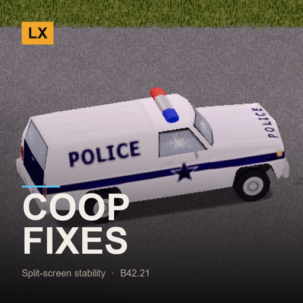

# LX Coop Fixes

**Split-screen stability for B42.21**

> The crashes, the stutter and the broken aiming that only show up when two people share one screen.

`Project Zomboid B42.21+` · `v1.3.0` · `CC0`

[English](#english) · [Español](#español) · [Русский](#русский)

---

## English

This mod is part of the **LX Split-Screen Suite**, seven mods that make Project Zomboid B42 playable in 2–4 player couch co-op, with or without a gamepad. Each one stands alone — install only what you need.

### Why split-screen?

Split-screen is the mode that carries the most bugs in stable B42 — and the mods worth playing with, like Bandits and Project A-Life, are built for singleplayer and online multiplayer. Nobody is fixing couch co-op. This suite exists to close that gap: to make split-screen as playable as the modes that get the attention.

### Why gamepad?

B42 keeps improving controller support, but it is still rough, and the aim-and-shoot rework left gunplay on a gamepad close to unusable — you cannot even shoot a zombie lying on the ground. Split-screen *with* a gamepad is the worst case the game offers. These mods give PZ back an aim that was designed for a stick: assist on the vertical axis, B41-style lock-on, per-player aim state, and a lot more.

### What it does

- **Vehicle crash while driving** — `BaseVehicle.update()` dereferences a null chunk when the previous chunk unloads — which happens constantly in split-screen, because two players pull chunks in and out at once. The game closes or hangs. The fix re-registers the vehicle in the chunk it is actually in, exactly like vanilla would an instant later.
- **Player 2 could not aim** — Several aiming routines convert the reticle position with the *global* current player's camera instead of the weapon owner's. For player 2 that meant the aim ray was cast from player 1's camera and never found the zombie: no green circle, no target lock, no hit chance. Each player now aims through their own camera.
- **Player 2+ had no reticle at all** — `CombatManager.update()` only ever refreshes player 1's reticle, so players 2–4 never got hit chance, reticle colours, or the “target found” state that makes the reticle stick to a zombie. They do now.
- **Stutter with the map or minimap open** — The unexplored-area fog lives in one texture covering the whole loaded world — 4096×4096 RGBA, 64 MB, on a world with distant modded maps. Every time anyone walks into an unexplored block, the game re-uploads all 64 MB. With two players exploring that is every few seconds. Now only the changed rows go up, a few KB instead of 64 MB. Same picture, no freeze.
- **Error spam in the log** — `IsoTree.isPlayerInsideARoom` throws a null-pointer exception every frame in some houses, `LungeState` throws when a zombie is exactly on top of its target, and building with a controller asks for a texture named `null`. All three are silenced at the source.
- **Lost Lock Picking XP** — The Lock Picking Skill mod asks the game for a sandbox multiplier that does not exist for modded skills, which throws and swallows the XP. Now the XP lands either way.
- **Menus and dialogs stayed on the other player's half** — Context menus never knew about split-screen at all. ISContextMenu.lua does not hold a single reference to the player's viewport in its 1237 lines: it measures and clips everything against the whole window, so a long menu overflowed into the other player's half, and a submenu folded to the left only at the window's RIGHT EDGE - which for player 1 never happens, so their submenus invaded player 2's half instead of folding. Menus now measure, fold and clamp against the half of whoever opened them, and this hit our own LX Split-Screen Quick Build hardest, because it generates the longest and deepest menus in the suite. Long scrolling dialogs had the same problem: B42.21 already centres ISModalDialog and ISTextBox on the right player, so nothing is touched there, but ISModalRichText re-measures every frame against the whole window and pins itself to the window's top edge, so player 2's dialog jumped onto player 1's screen the moment it grew.

### Requirements

| Mod | Workshop | |
|---|---|---|
| ZombieBuddy | [3619862853](https://steamcommunity.com/sharedfiles/filedetails/?id=3619862853) | required |
| Lock Picking Skill (B42) | [3774467540](https://steamcommunity.com/sharedfiles/filedetails/?id=3774467540) | optional |

**Load order:** load this **after** `ZombieBuddy`, `Cf_LockpickingSkill`. `mod.info` already declares it.

### Installing

**From the Steam Workshop (recommended)**
Subscribe on the Workshop page. Steam downloads it; then start Project Zomboid, go to
**Mods** in the main menu and enable it. In split-screen, enabling it once covers all players.

**Manually**
1. Download this repository (green **Code** button -> **Download ZIP**) and unzip it.
2. Copy the folder `LX_CoopFixes` into your Zomboid mods folder:
   - Windows: `C:\Users\<you>\Zomboid\mods\`
   - Linux: `~/Zomboid/mods/`
   - macOS: `~/Library/Application Support/Zomboid/mods/`
   The result must be `...\Zomboid\mods\LX_CoopFixes\42\mod.info`.
3. Start the game, open **Mods** in the main menu and enable **LX Coop Fixes**.

### Notes

- Every patch is guarded: on any unexpected state it steps aside and the game runs exactly as vanilla. Nothing here changes balance or gameplay.
- The map fog optimisation disables itself after repeated errors and falls back to the game's own full upload.
- Needs [ZombieBuddy](https://steamcommunity.com/sharedfiles/filedetails/?id=3619862853) 2.3.0+ to load its Java patches. No loose class files are installed. The first time you launch with it, ZombieBuddy shows a dialog naming this mod's JAR and its SHA-256, and loads nothing until you approve it: that is ZombieBuddy doing its job, not an error. Tick remember so it stops asking. If you run ZombieBuddy with policy=deny-new, approve it there first or the JAR is skipped in silence.

### License

**CC0 1.0 Universal** — public domain dedication. Do whatever you want with it: copy it, change it, put it in a modpack, publish it, sell it. No permission needed, no credit required (though it is always welcome). See `LICENSE`.

### Support

If these mods made your co-op run work, you can buy me a coffee — 

### The rest of the suite

- [LX Split Aim](https://github.com/litoxperaloca/LX_SplitAim) — Controller aim assist and B41-style lock-on, per local player.
- [LX Split-Screen Quick Build](https://github.com/litoxperaloca/LX_SPLITSCREEN_CONTEXTMENU_BUILDING) — B41-style build menu in the context menu, because B42's window does not fit.
- [LX A-Life Split-Screen Fix](https://github.com/litoxperaloca/LX_ALifeSplit) — Project A-Life NPCs react to every local player, not just player 1.
- [LX Bandits Split-Screen Fix](https://github.com/litoxperaloca/LX_BanditsSplit) — Bandits target the right player, companions follow who recruited them.
- [LX Split-Screen Welcome Package](https://github.com/litoxperaloca/LX_SPLITSCREEN_WELCOME_PACKAGE) — A configurable starter kit per local character.
- [LX Split-Screen Skills Boost](https://github.com/litoxperaloca/LX_SPLITSCREEN_SKILLS_IMPROVE) — A configurable skill floor per local character.
- [LX Theodore Split-Screen Fix](https://github.com/litoxperaloca/LX_TheodoreSplit) — Theodore, the family NPC, reacts to every local player and works with a gamepad.
- [LX NPC Bases Split-Screen Fix](https://github.com/litoxperaloca/LX_NPCBasesSplit) — Bandit settlements open on your half of the screen, take a gamepad, and keep appearing as you travel.
- [LX HydeCo Underground Split-Screen Fix](https://github.com/litoxperaloca/LX_HydeCoSplit) — Each player gets their own breathing panel underground, opened and driven by their own gamepad.

---

## Español

> Los crashes, los tirones y el apuntado roto que solo aparecen cuando dos personas comparten una pantalla.

Este mod es parte de la **LX Split-Screen Suite**, siete mods que hacen jugable Project Zomboid B42 en coop de sillón de 2 a 4 jugadores, con o sin mando. Cada uno funciona por separado — instalá solo lo que precises.

### ¿Por qué pantalla dividida?

Es la modalidad con más bugs en la B42 estable — y los mods que valen la pena, como Bandits y Project A-Life, están pensados para un jugador y multijugador online. Nadie arregla el coop de sillón. Esta suite existe para cerrar esa brecha: dejar la pantalla dividida a la par de las modalidades que sí reciben atención.

### ¿Por qué mando?

La B42 viene mejorando el soporte de mando, pero todavía deja mucho que desear, y el rework de apuntado y disparo dejó el tiroteo con mando casi imposible — ni siquiera podés dispararle a un zombi en el suelo. Pantalla dividida *con* mando es el peor escenario posible del juego. Estos mods le devuelven a PZ un apuntado pensado para stick: asistencia en el eje vertical, fijado de blanco estilo B41, estado de apuntado por jugador, y bastante más.

### Qué hace

- **Crash de vehículos al manejar** — `BaseVehicle.update()` usa un chunk nulo cuando el chunk anterior se descarga — algo que en pantalla dividida pasa todo el tiempo, porque dos jugadores cargan y descargan chunks a la vez. El juego se cierra o se cuelga. El arreglo re-registra el vehículo en el chunk donde está realmente, igual que haría el juego un instante después.
- **El jugador 2 no podía apuntar** — Varias rutinas de apuntado convierten la posición del retículo con la cámara del jugador actual *global* en vez de la del dueño del arma. Para el jugador 2 eso significaba que el rayo salía de la cámara del jugador 1 y nunca encontraba al zombi: sin círculo verde, sin fijado, sin probabilidad de acierto. Ahora cada jugador apunta con su propia cámara.
- **El jugador 2+ no tenía retículo** — `CombatManager.update()` solo actualiza el retículo del jugador 1, así que los jugadores 2 a 4 nunca veían probabilidad de acierto, colores del retículo, ni el estado de “blanco encontrado” que hace que el retículo se pegue al zombi. Ahora sí.
- **Tirones con el mapa o el minimapa abierto** — La niebla de zonas no visitadas vive en una sola textura que cubre todo el mundo cargado — 4096×4096 RGBA, 64 MB, en un mundo con mapas modded lejanos. Cada vez que alguien entra en un bloque sin explorar, el juego vuelve a subir los 64 MB completos. Con dos jugadores explorando eso pasa cada pocos segundos. Ahora suben solo las filas que cambiaron, unos KB en vez de 64 MB. Misma imagen, sin congelamiento.
- **Spam de errores en el log** — `IsoTree.isPlayerInsideARoom` lanza una excepción de puntero nulo en cada cuadro en algunas casas, `LungeState` falla cuando un zombi queda exactamente sobre su objetivo, y construir con mando pide una textura llamada `null`. Los tres quedan silenciados en el origen.
- **XP de forzado de cerraduras que se perdía** — El mod Lock Picking Skill le pide al juego un multiplicador de sandbox que no existe para habilidades de mods, lo que falla y se traga la XP. Ahora la XP se suma igual.
- **Los menus y los dialogos se iban a la mitad del otro jugador** — Los menus contextuales nunca supieron que existe la pantalla dividida. ISContextMenu.lua no tiene una sola referencia al viewport del jugador en sus 1237 lineas: mide y recorta todo contra la ventana entera, asi que un menu largo se derramaba en la mitad del otro, y un submenu se plegaba a la izquierda solo al chocar con el BORDE DERECHO de la ventana, cosa que para el jugador 1 no pasa nunca, asi que sus submenus invadian la mitad del jugador 2 en vez de plegarse. Ahora los menus se miden, se pliegan y se recortan contra la mitad de quien los abrio, y esto nos pegaba a nosotros mas que a nadie: LX Split-Screen Quick Build genera los menus mas largos y profundos de la suite. Los dialogos largos con scroll tenian el mismo problema: B42.21 ya centra ISModalDialog e ISTextBox en el jugador correcto, asi que ahi no se toca nada, pero ISModalRichText se vuelve a medir cada frame contra la ventana entera y se pega al borde superior, asi que el dialogo del jugador 2 se le iba a la pantalla del jugador 1 apenas crecia.

### Requisitos

| Mod | Workshop | |
|---|---|---|
| ZombieBuddy | [3619862853](https://steamcommunity.com/sharedfiles/filedetails/?id=3619862853) | obligatorio |
| Lock Picking Skill (B42) | [3774467540](https://steamcommunity.com/sharedfiles/filedetails/?id=3774467540) | opcional |

**Orden de carga:** cargá este **después** de `ZombieBuddy`, `Cf_LockpickingSkill`. El `mod.info` ya lo declara.

### Instalación

**Desde el Steam Workshop (recomendado)**
Suscribite en la página del Workshop. Steam lo descarga solo; después abrí Project Zomboid,
andá a **Mods** en el menú principal y activalo. En pantalla dividida, con activarlo una vez
alcanza para todos los jugadores.

**A mano**
1. Descargá este repositorio (botón verde **Code** -> **Download ZIP**) y descomprimilo.
2. Copiá la carpeta `LX_CoopFixes` a tu carpeta de mods de Zomboid:
   - Windows: `C:\Users\<vos>\Zomboid\mods\`
   - Linux: `~/Zomboid/mods/`
   - macOS: `~/Library/Application Support/Zomboid/mods/`
   Tiene que quedar `...\Zomboid\mods\LX_CoopFixes\42\mod.info`.
3. Abrí el juego, entrá a **Mods** en el menú principal y activá **LX Coop Fixes**.

### Notas

- Cada parche tiene guardas: ante cualquier estado inesperado se hace a un lado y el juego corre exactamente como vanilla. Nada de acá cambia balance ni jugabilidad.
- La optimización de la niebla del mapa se desactiva sola si acumula errores y vuelve a la subida completa del juego.
- Necesita [ZombieBuddy](https://steamcommunity.com/sharedfiles/filedetails/?id=3619862853) 2.3.0+ para cargar sus parches Java. No instala clases sueltas. La primera vez que arranques con el, ZombieBuddy muestra un dialogo con el JAR de este mod y su SHA-256, y no carga nada hasta que lo apruebes: eso es ZombieBuddy haciendo su trabajo, no un error. Tilda recordar para que no pregunte mas. Si usas ZombieBuddy con policy=deny-new, aprobalo ahi primero o el JAR se saltea en silencio.

### Licencia

**CC0 1.0 Universal** — dedicado al dominio público. Hacé lo que quieras: copialo, cambialo, metélo en un modpack, publicalo, vendelo. No hace falta permiso ni crédito (aunque siempre se agradece). Ver `LICENSE`.

### Apoyar

Si estos mods te arreglaron el coop, podés invitarme un café — 

### El resto de la suite

- [LX Split Aim](https://github.com/litoxperaloca/LX_SplitAim) — Asistencia de apuntado con mando y fijado de blanco estilo B41, por jugador local.
- [LX Split-Screen Quick Build](https://github.com/litoxperaloca/LX_SPLITSCREEN_CONTEXTMENU_BUILDING) — Menú de construcción estilo B41 en el menú contextual, porque la ventana de B42 no entra.
- [LX A-Life Split-Screen Fix](https://github.com/litoxperaloca/LX_ALifeSplit) — Los NPCs de Project A-Life reaccionan a todos los jugadores locales, no solo al 1.
- [LX Bandits Split-Screen Fix](https://github.com/litoxperaloca/LX_BanditsSplit) — Los bandidos apuntan al jugador correcto, los compañeros siguen a quien los reclutó.
- [LX Split-Screen Welcome Package](https://github.com/litoxperaloca/LX_SPLITSCREEN_WELCOME_PACKAGE) — Un equipo inicial configurable por personaje local.
- [LX Split-Screen Skills Boost](https://github.com/litoxperaloca/LX_SPLITSCREEN_SKILLS_IMPROVE) — Un piso de habilidades configurable por personaje local.
- [LX Theodore Split-Screen Fix](https://github.com/litoxperaloca/LX_TheodoreSplit) — Theodore, el NPC familiar, reacciona a todos los jugadores locales y anda con mando.
- [LX NPC Bases Split-Screen Fix](https://github.com/litoxperaloca/LX_NPCBasesSplit) — Los asentamientos de bandidos se abren en tu mitad de pantalla, andan con mando, y siguen apareciendo mientras viajas.
- [LX HydeCo Underground Split-Screen Fix](https://github.com/litoxperaloca/LX_HydeCoSplit) — Cada jugador tiene su propio panel de respiracion bajo tierra, abierto y manejado con su propio mando.

---

## Русский

> Вылеты, подтормаживания и сломанное прицеливание, которые проявляются только когда два человека делят один экран.

Этот мод входит в набор **LX Split-Screen Suite** — семь модов, которые делают Project Zomboid B42 играбельным в совместной игре на диване для 2–4 человек, с геймпадом или без. Каждый работает сам по себе — ставьте только нужное.

### Почему разделённый экран?

Разделённый экран — режим с наибольшим числом ошибок в стабильной B42, а моды, ради которых стоит играть, вроде Bandits и Project A-Life, сделаны под одиночную игру и сетевой мультиплеер. Совместной игрой на диване не занимается никто. Этот набор существует, чтобы закрыть пробел: сделать разделённый экран таким же играбельным, как режимы, которым достаётся внимание.

### Почему геймпад?

B42 продолжает улучшать поддержку контроллеров, но она всё ещё сырая, а переработка прицеливания и стрельбы сделала перестрелки с геймпада почти невозможными — вы даже не можете выстрелить в зомби, лежащего на полу. Разделённый экран *вместе* с геймпадом — худший случай, который предлагает игра. Эти моды возвращают PZ прицеливание, рассчитанное на стик: помощь по вертикальной оси, захват цели в стиле B41, отдельное состояние прицеливания для каждого игрока и многое другое.

### Что делает

- **Вылет транспорта во время езды** — `BaseVehicle.update()` обращается к пустому чанку, когда предыдущий выгружается — при разделённом экране это происходит постоянно, потому что два игрока одновременно подгружают и выгружают чанки. Игра закрывается или зависает. Исправление заново регистрирует транспорт в том чанке, где он сейчас находится, ровно так же, как игра сделала бы мгновением позже.
- **Второй игрок не мог прицелиться** — Несколько процедур прицеливания переводят позицию прицела через камеру *глобального* текущего игрока, а не владельца оружия. Для второго игрока это означало, что луч наводки шёл от камеры первого и никогда не находил зомби: ни зелёного круга, ни захвата цели, ни шанса попадания. Теперь каждый игрок целится через свою камеру.
- **У игроков 2+ вообще не было прицела** — `CombatManager.update()` обновляет прицел только первого игрока, поэтому игроки со второго по четвёртого никогда не получали шанс попадания, цвета прицела и состояние «цель найдена», из-за которого прицел прилипает к зомби. Теперь получают.
- **Подтормаживания при открытой карте или миникарте** — Туман неисследованных зон хранится в одной текстуре, покрывающей весь загруженный мир — 4096×4096 RGBA, 64 МБ, на мире с далёкими модовыми картами. Каждый раз, когда кто-то заходит в неисследованный блок, игра заново загружает все 64 МБ. При двух исследующих игроках это происходит каждые несколько секунд. Теперь отправляются только изменившиеся строки — несколько КБ вместо 64 МБ. Картинка та же, подвисаний нет.
- **Поток ошибок в логе** — `IsoTree.isPlayerInsideARoom` выбрасывает исключение каждый кадр в некоторых домах, `LungeState` падает, когда зомби стоит ровно на своей цели, а строительство с геймпада запрашивает текстуру с именем `null`. Все три случая устранены в источнике.
- **Потерянный опыт взлома замков** — Мод Lock Picking Skill запрашивает у игры множитель песочницы, которого для модовых навыков не существует, из-за чего происходит ошибка и опыт теряется. Теперь опыт начисляется в любом случае.
- **Меню и диалоги заезжали на половину другого игрока** — Контекстные меню вообще не знали о разделённом экране. В ISContextMenu.lua нет ни одной ссылки на область игрока на все 1237 строк: он измеряет и обрезает всё относительно всего окна, поэтому длинное меню переливалось на половину другого игрока, а подменю складывалось влево только у ПРАВОГО КРАЯ окна, чего у первого игрока не бывает никогда. Теперь меню измеряются, складываются и обрезаются по половине того, кто их открыл, и сильнее всего это било по нашему же LX Split-Screen Quick Build, который создаёт самые длинные меню набора. У длинных диалогов с прокруткой была та же беда: B42.21 уже центрирует ISModalDialog и ISTextBox правильно, там ничего не трогается, но ISModalRichText каждый кадр пересчитывается относительно всего окна и прижимается к его верхнему краю, поэтому диалог второго игрока уезжал на экран первого, едва начав расти.

### Требования

| Mod | Workshop | |
|---|---|---|
| ZombieBuddy | [3619862853](https://steamcommunity.com/sharedfiles/filedetails/?id=3619862853) | обязательно |
| Lock Picking Skill (B42) | [3774467540](https://steamcommunity.com/sharedfiles/filedetails/?id=3774467540) | необязательно |

**Порядок загрузки:** загружайте этот мод **после** `ZombieBuddy`, `Cf_LockpickingSkill`. `mod.info` уже это объявляет.

### Установка

**Из Steam Workshop (рекомендуется)**
Подпишитесь на странице Workshop. Steam скачает мод сам; затем запустите Project Zomboid,
откройте **Моды** в главном меню и включите его. При разделённом экране достаточно включить
один раз — это работает для всех игроков.

**Вручную**
1. Скачайте этот репозиторий (зелёная кнопка **Code** -> **Download ZIP**) и распакуйте.
2. Скопируйте папку `LX_CoopFixes` в папку модов Zomboid:
   - Windows: `C:\Users\<вы>\Zomboid\mods\`
   - Linux: `~/Zomboid/mods/`
   - macOS: `~/Library/Application Support/Zomboid/mods/`
   Должно получиться `...\Zomboid\mods\LX_CoopFixes\42\mod.info`.
3. Запустите игру, откройте **Моды** в главном меню и включите **LX Coop Fixes**.

### Примечания

- Каждый патч защищён: при любом неожиданном состоянии он отходит в сторону и игра работает точно как обычно. Ничто здесь не меняет баланс или геймплей.
- Оптимизация тумана карты отключается сама после повторяющихся ошибок и возвращается к штатной полной загрузке.
- Требуется ZombieBuddy 2.3.0+ для загрузки Java-патчей. Отдельные class-файлы не устанавливаются.

### Лицензия

**CC0 1.0 Universal** — передано в общественное достояние. Делайте что угодно: копируйте, изменяйте, включайте в сборки модов, публикуйте, продавайте. Разрешение не требуется, указание авторства не обязательно (но всегда приятно). См. `LICENSE`.

### Поддержать

Если эти моды помогли вашей совместной игре, можете угостить меня кофе — 

### Остальные моды набора

- [LX Split Aim](https://github.com/litoxperaloca/LX_SplitAim) — Помощь прицеливания с геймпада и захват цели в стиле B41 для каждого локального игрока.
- [LX Split-Screen Quick Build](https://github.com/litoxperaloca/LX_SPLITSCREEN_CONTEXTMENU_BUILDING) — Меню строительства в стиле B41 в контекстном меню, потому что окно B42 не помещается.
- [LX A-Life Split-Screen Fix](https://github.com/litoxperaloca/LX_ALifeSplit) — NPC из Project A-Life реагируют на всех локальных игроков, а не только на первого.
- [LX Bandits Split-Screen Fix](https://github.com/litoxperaloca/LX_BanditsSplit) — Бандиты целятся в нужного игрока, напарники следуют за тем, кто их нанял.
- [LX Split-Screen Welcome Package](https://github.com/litoxperaloca/LX_SPLITSCREEN_WELCOME_PACKAGE) — Настраиваемый стартовый набор для каждого локального персонажа.
- [LX Split-Screen Skills Boost](https://github.com/litoxperaloca/LX_SPLITSCREEN_SKILLS_IMPROVE) — Настраиваемый минимальный уровень навыков для каждого локального персонажа.
- [LX Theodore Split-Screen Fix](https://github.com/litoxperaloca/LX_TheodoreSplit) — Theodore реагирует на всех локальных игроков и работает с геймпадом.
- [LX NPC Bases Split-Screen Fix](https://github.com/litoxperaloca/LX_NPCBasesSplit) — Поселения бандитов открываются на вашей половине экрана, работают с геймпадом и продолжают появляться по мере путешествия.
- [LX HydeCo Underground Split-Screen Fix](https://github.com/litoxperaloca/LX_HydeCoSplit) — У каждого игрока своя панель дыхания под землёй, открываемая и управляемая своим геймпадом.

